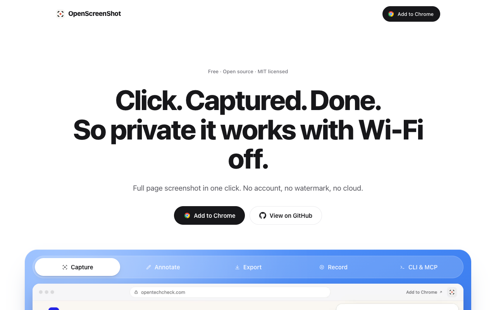
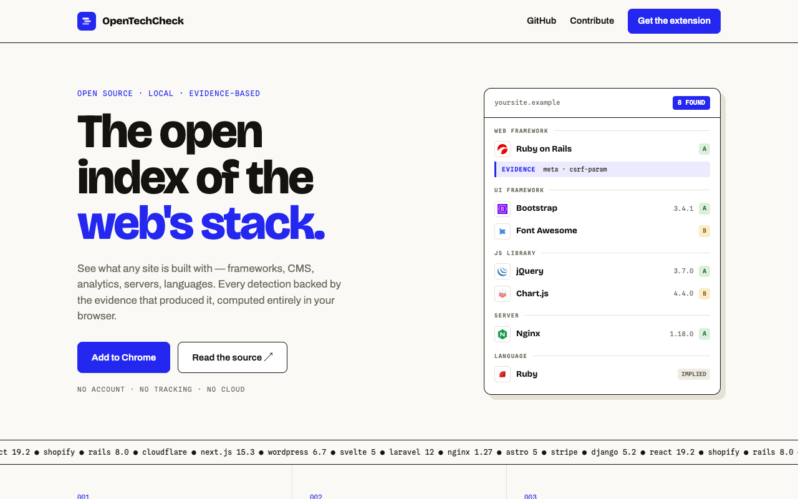
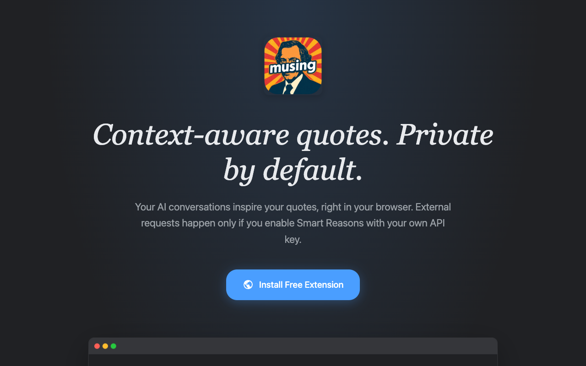
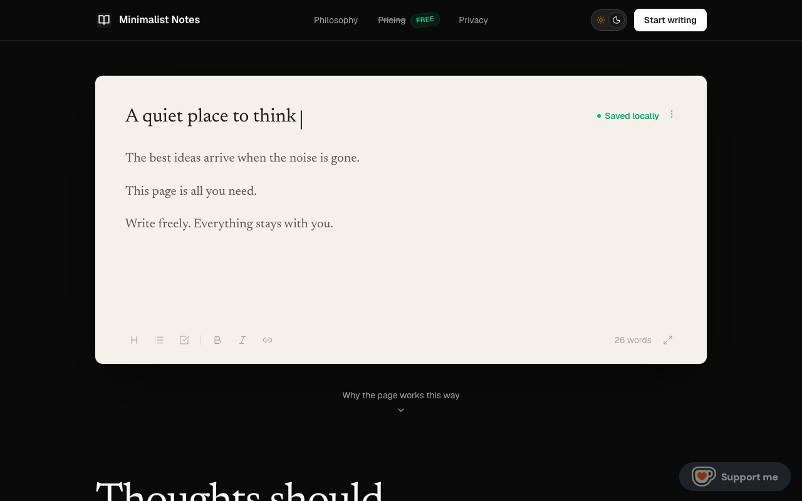
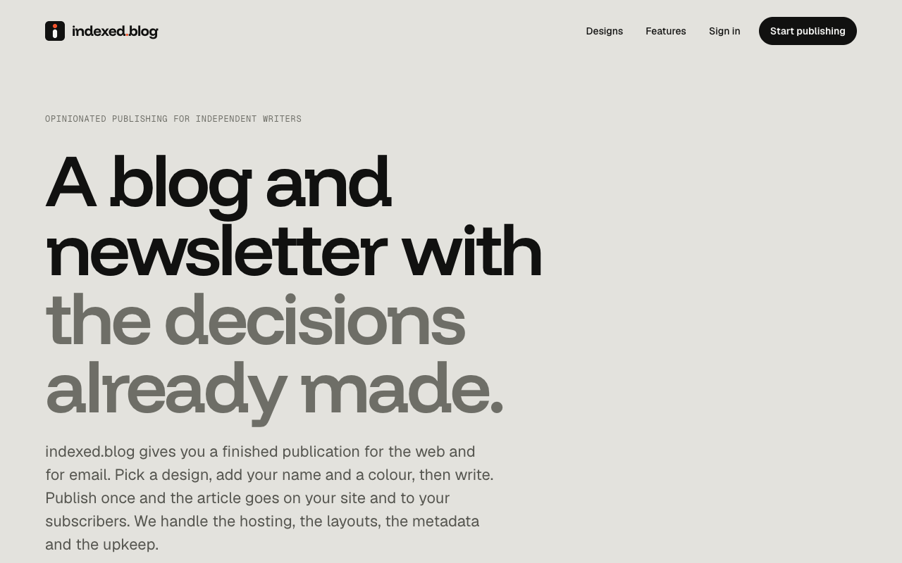

  
  
  
  
  

I'm PG, a builder in Tokyo. I work the whole stack, from the first pixel to the last database index. I make small, fast tools that respect the person using them: no account, no tracking, and most of them work with the Wi-Fi off.

Right now: fast sites on the edge, honest interfaces, local-first software. Off the keyboard: road bicycling.

## 01 · Workshop

**[OpenScreenShot](https://openscreenshot.app)** · Full-page screenshots in one click. Annotate, record the tab, export. No account, no watermark, no cloud.
 

<table>
  <tr>
    <td width="50%" valign="top">
      
      
<b><a href="https://opentechcheck.com">OpenTechCheck</a></b> · See what any website is built with. Every detection shows the signal that produced it. Runs in your browser.

      
    </td>
    <td width="50%" valign="top">
      
      
<b><a href="https://musing.wiki">Musing</a></b> · New-tab quotes matched to your AI conversations. Extracted locally, private by default.

      
    </td>
  </tr>
  <tr>
    <td width="50%" valign="top">
      
      
<b><a href="https://minimalistnotes.com">Minimalist Notes</a></b> · A quiet page to write on. Opens instantly, saves to your device, works offline.

    </td>
    <td width="50%" valign="top">
      
      
<b><a href="https://indexed.blog">indexed.blog</a></b> · Opinionated publishing for independent writers. Site, newsletter and hosting in one. Four decisions, then write.

    </td>
  </tr>
</table>

## 02 · Desk

- [A form can be the front door](https://pghq.dev/writing/a-form-can-be-the-front-door) · 2026-09-04

## 03 · Toolbox

  
   
  

  
  

<picture>
  <source media="(prefers-color-scheme: dark)" srcset="https://raw.githubusercontent.com/PGHQdev/PGHQdev/output/snake-dark.svg">
  
</picture>

## 04 · Front door

The door's always open. Hiring, collaboration, or just saying hi: knock at [pghq.dev](https://pghq.dev) or write to [hello@pghq.dev](mailto:hello@pghq.dev).

